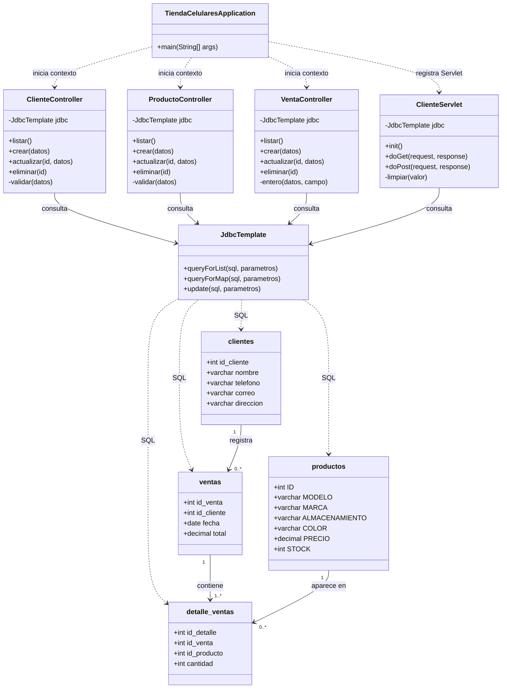

# Diagrama de clases y modelo de datos

## Componentes de la aplicación

## Explicación

- `TiendaCelularesApplication` es el punto de entrada de Spring Boot.
- `ClienteController`, `ProductoController` y `VentaController` exponen operaciones REST para gestionar la información.
- `ClienteServlet` ofrece una segunda interfaz web para consultar, filtrar y registrar clientes mediante una vista JSP.
- `JdbcTemplate` centraliza la comunicación con MariaDB mediante consultas parametrizadas.
- En el modelo relacional, un cliente puede tener varias ventas; una venta puede tener varios detalles; y un producto puede aparecer en diferentes detalles de venta.
