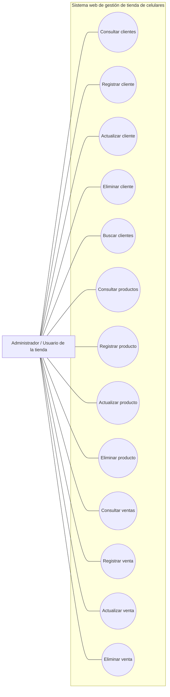

# Diagrama de casos de uso

## Descripción de los casos de uso

| Caso de uso | Descripción | Componente |
|---|---|---|
| Consultar clientes | Muestra los clientes registrados. | `ClienteController` / `ClienteServlet` |
| Registrar cliente | Guarda un cliente después de validar los campos obligatorios. | `ClienteController` / `ClienteServlet` |
| Actualizar cliente | Modifica los datos de un cliente existente. | `ClienteController` |
| Eliminar cliente | Elimina un cliente si no tiene ventas asociadas. | `ClienteController` |
| Buscar clientes | Filtra por nombre o correo. | `ClienteServlet` |
| Consultar productos | Lista los productos disponibles. | `ProductoController` |
| Registrar producto | Crea un producto validando precio y stock. | `ProductoController` |
| Actualizar producto | Modifica la información de un producto. | `ProductoController` |
| Eliminar producto | Elimina un producto si no está relacionado con detalles de ventas. | `ProductoController` |
| Consultar ventas | Lista las ventas con información del cliente. | `VentaController` |
| Registrar venta | Registra una venta asociada a un cliente existente. | `VentaController` |
| Actualizar venta | Modifica los datos generales de una venta. | `VentaController` |
| Eliminar venta | Elimina la venta y sus detalles asociados. | `VentaController` |

## Actor

**Administrador / Usuario de la tienda:** interactúa con el sistema para administrar clientes, productos y ventas. El proyecto no implementa autenticación ni roles en el alcance documentado.
